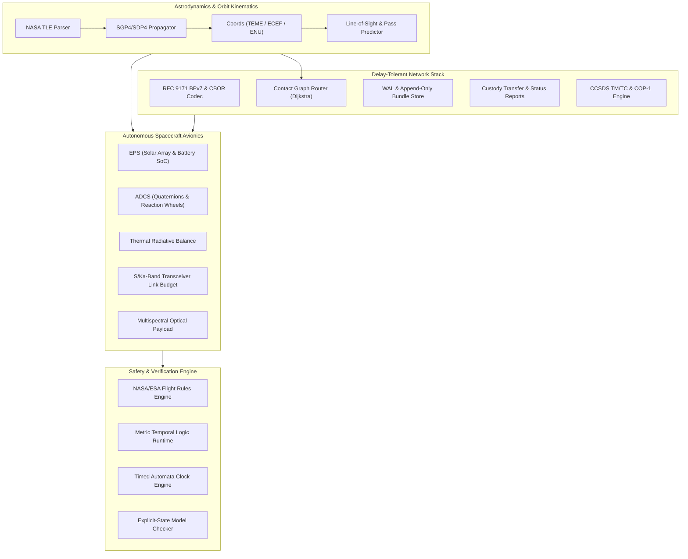

# Apogee

```text
      ___       ______     ______     _______  _______  _______
     /   \\     |   _  \\   /  __  \\   /  _____||   ____||   ____|
    /  ^  \\    |  |_)  | |  |  |  | |  |  __  |  |__   |  |__
   /  /_\\  \\   |   ___/  |  |  |  | |  | |_ | |   __|  |   __|
  /  _____  \\  |  |      |  `--'  | |  |__| | |  |____ |  |____
 /__/     \\__\\ | _|       \\______/   \\______| |_______||_______|
```

> **Autonomous Orbital Avionics Kernel and Delay-Tolerant Mesh Network in Pure Erlang/OTP**

[](https://www.erlang.org/)
[](LICENSE)
[]()
[]()

---

## Overview

Apogee is an autonomous orbital avionics flight software kernel, delay-tolerant mesh networking router, and Walker-Delta satellite constellation simulator written from first principles in pure Erlang/OTP. 

Modern space systems operate under harsh constraints: intermittent line-of-sight visibility, non-negligible propagation delays (seconds to hours), strict power envelopes, radiation-induced bit flips, and high dynamics. Apogee addresses these operational realities by fusing orbital mechanics, consultative space communication standards, store-and-forward bundle networking, and formal verification into a single concurrent runtime.

Key capabilities include:
- **Astrodynamics**: High-precision SGP4/SDP4 analytical orbit propagation, WGS-84 coordinate transformations (TEME, ECEF, ENU, Geodetic), topocentric line-of-sight analysis, and Earth limb occultation geometry.
- **CCSDS Space Link Protocols**: Space Packet Protocol (SPP), Telecommand (TC) frames, Telemetry (TM) frames, Command Operation Procedure 1 (COP-1) with Sequence-Controlled Service, CCSDS pseudo-random scrambler, and Reed-Solomon (255, 223) error correction.
- **Delay-Tolerant Networking (DTN)**: RFC 9171 Bundle Protocol Version 7 (BPv7) with CBOR serialization, IPN/DTN Endpoint Identifiers (EID), Bundle Protocol Security (BPsec), autonomous custody transfer, and fragmentation.
- **Contact Graph Routing (CGR)**: Multi-hop time-expanded Dijkstra routing engine computing Earliest Delivery Time (EDT) over dynamic orbital contact topologies, with link volume reservations and reactive deflection.
- **Autonomous Avionics**: Closed-loop Electrical Power System (EPS) with solar illumination geometry and battery state-of-charge integration, 4-node thermal radiative balance, Attitude Determination and Control System (ADCS) with Rodrigues quaternion integration and reaction wheel desaturation, and RF link budget SDR modeling.
- **Formal Verification Engine**: Real-time timed automata with clock guards and location invariants, quantitative Metric Temporal Logic (MTL) runtime monitoring, and explicit-state model checking for deadlock-freedom and invariant satisfaction.
- **Simulation and Operations**: Walker-Delta constellation generator ($i: T/P/F$), ground station pass predictor, aerospace chaos and Single Event Upset (SEU) fault injector, ANSI full-screen terminal mission control dashboard, and polyglot glue (C, Python, TypeScript).

---

## Architectural Topology

The kernel is structured as a supervision tree of functional subsystems and concurrent actors:



---

## Mathematical Foundations

### 1. SGP4 Orbital Perturbations
The orbital propagator incorporates secular and periodic gravitational perturbations derived from the Earth gravitational potential expansion:

$$U(r, \phi) = \frac{\mu}{r} \left[ 1 - \sum_{n=2}^{\infty} J_n \left(\frac{R_\oplus}{r}\right)^n P_n(\sin \phi) \right]$$

The primary secular drift rates for the argument of perigee ($\omega$) and right ascension of ascending node ($\Omega$) due to Earth oblateness ($J_2 = 1.08263 \times 10^{-3}$) are computed as:

$$\dot{\Omega} = -\frac{3}{2} n J_2 \left(\frac{R_\oplus}{p}\right)^2 \cos i$$

$$\dot{\omega} = \frac{3}{4} n J_2 \left(\frac{R_\oplus}{p}\right)^2 (5\cos^2 i - 1)$$

where $p = a(1 - e^2)$ is the semi-latus rectum and $n = \sqrt{\mu / a^3}$ is the mean motion.

### 2. Spacecraft Attitude Kinematics
Attitude orientation is parameterized using unit quaternions $\mathbf{q} = [q_0, \mathbf{q}_v]^T \in \mathbb{H}$ to avoid Euler angle gimbal lock. Kinematic propagation under body angular velocity $\boldsymbol{\omega}$ over time step $\Delta t$ uses the closed-form Rodrigues quaternion exponential:

$$\Delta\theta = \|\boldsymbol{\omega}\|\Delta t, \quad \hat{\mathbf{u}} = \frac{\boldsymbol{\omega}}{\|\boldsymbol{\omega}\|}$$

$$\mathbf{q}(t + \Delta t) = \left[ \cos\left(\frac{\Delta\theta}{2}\right) + \hat{\mathbf{u}}\sin\left(\frac{\Delta\theta}{2}\right) \right] \otimes \mathbf{q}(t)$$

### 3. Attitude Dynamics & Reaction Wheel Desaturation
Rigid-body rotational dynamics under internal reaction wheel momentum $\mathbf{h}_w$ follow Euler equations:

$$\mathbf{I}\dot{\boldsymbol{\omega}} + \boldsymbol{\omega} \times (\mathbf{I}\boldsymbol{\omega} + \mathbf{h}_w) = \boldsymbol{\tau}_{ext} - \boldsymbol{\tau}_w$$

When reaction wheels approach speed limits ($|\Omega_w| \ge \Omega_{max}$), magnetic torque rods fire to dump angular momentum against the local geomagnetic field $\mathbf{B}_{LEO}$:

$$\boldsymbol{\tau}_{mag} = \mathbf{m}_{dipole} \times \mathbf{B}_{LEO}, \quad \mathbf{m}_{dipole} = \frac{\mathbf{h}_w \times \mathbf{B}_{LEO}}{\|\mathbf{B}_{LEO}\|^2}$$

### 4. RF Link Budget & Adaptive Modulation
Free-space path loss and received carrier-to-noise spectral density ratio follow the Friis transmission formula:

$$FSPL(d, f) = 20\log_{10}(d) + 20\log_{10}(f) + 20\log_{10}\left(\frac{4\pi}{c}\right)$$

$$\frac{E_b}{N_0} = EIRP - FSPL - L_{atm} + \left(\frac{G}{T}\right)_{rx} - k_B - 10\log_{10}(R_b)$$

The transceiver dynamically selects modulation and coding (BPSK, QPSK, 8PSK, 16APSK) to maximize channel throughput while preserving a minimum 3.0 dB link margin.

### 5. Contact Graph Routing (CGR) Dijkstra Engine
Given a time-varying contact plan consisting of directional transmission windows $C_k = (u, v, t_s, t_e, R, d_{prop})$, the routing algorithm finds the path minimizing arrival time $T_{arr}$:

$$T_{arr}(v) = \max(T_{arr}(u), t_s) + d_{prop} + \frac{S_{bundle}}{R}$$

Subject to capacity constraints $\int R \, dt \ge S_{bundle}$. When links degrade or undergo eclipse, the router calculates reactive deflection paths across secondary orbital planes.

---

## Subsystem Architecture

### 1. Astrodynamics & Coordinate Frames (`src/apogee_*`)
- `apogee_tle`: NASA/NORAD Two-Line Element (TLE) parser with modulo-10 checksum validation.
- `apogee_sgp4`: Complete SGP4 analytical propagator yielding TEME state vectors.
- `apogee_coords`: Greenwich Apparent Sidereal Time (GAST) transformations between TEME, ECEF, and geodetic reference frames on the WGS-84 ellipsoid.
- `apogee_los`: Topocentric azimuth, elevation, slant range, Doppler shift, and ray-sphere grazing altitude for Earth limb occultation.
- `apogee_contact_predictor`: Autonomous pass computation generating AOS, LOS, and TCA events.

### 2. CCSDS Space Data Communications
- `apogee_spp`: Space Packet Protocol (CCSDS 133.0-B-1) packetizer with 48-bit coarse/fine mission elapsed time.
- `apogee_tc` & `apogee_tm`: Telecommand and Telemetry Transfer Frame assemblers and parsers.
- `apogee_cop1`: Command Operation Procedure 1 state machine implementing Sequence-Controlled Service (FARM-1) and Expedited Service.
- `apogee_clcw`: Command Link Control Word generator reporting frame acceptance and retransmit flags.
- `apogee_scrambler`: CCSDS pseudo-random bitstream scrambler ($x^8 + x^7 + x^5 + x^3 + 1$).
- `apogee_rs`: Reed-Solomon $(255, 223)$ codec operating over Galois Field $GF(2^8)$ with Berlekamp-Massey and Chien search.
- `apogee_ldpc`: Low-Density Parity-Check matrix structures for telemetry encoding.

### 3. Delay-Tolerant Networking (RFC 9171 BPv7)
- `apogee_bpv7`: Full RFC 9171 Bundle Protocol Version 7 implementation with CBOR canonical serialization.
- `apogee_eid`: Uniform Resource Identifier parser for `ipn:` and `dtn:` endpoint identifiers.
- `apogee_admin_record`: Administrative record generator and parser for Bundle Status Reports.
- `apogee_custody`: Autonomous custody acceptance, verification, and retransmission signals.
- `apogee_fragment`: Reactive and proactive payload fragmentation with offset reassembly.
- `apogee_bpsec`: Bundle Protocol Security (BPsec / RFC 9172) block framing and HMAC-SHA256 authentication.

### 4. Contact Graph Routing & Storage
- `apogee_contact_plan`: Temporal index of scheduled space communications links.
- `apogee_cgr`: Dijkstra-based earliest-delivery-time router with contact capacity tracking.
- `apogee_cgr_router`: Gen_server routing daemon with reactive path deflection and re-routing.
- `apogee_wal`: Append-only Write-Ahead Log with CRC-32 block framing for crash recovery.
- `apogee_bundle_store`: Persistent bundle repository indexed by bundle ID, destination, and priority.
- `apogee_bundle_queue`: Priority-aware FIFO queue with bundle expiration and drop policies.

### 5. Autonomous Spacecraft Avionics
- `apogee_eps`: Solar array illumination model with beta angle geometry and battery SoC numerical integration.
- `apogee_adcs`: Singularity-free quaternion attitude kinematics, Euler dynamics, and magnetic torquer desaturation.
- `apogee_thermal`: Multi-node lumped parameter thermal model (solar array, electronics, battery, optical payload).
- `apogee_transceiver`: S-band and Ka-band software-defined radio link budget model with adaptive modulation.
- `apogee_payload`: Multispectral optical Earth observation instrument capturing visible, NIR, and thermal bands.
- `apogee_satellite`: Top-level spacecraft state machine coordinating flight modes (Safe Hold, Detumble, Sun Pointing, Science, Downlink).

### 6. Formal Verification & Safety Engines
- `apogee_timed_automata`: Real-time timed automata engine with continuous clocks, reset transitions, and location invariants.
- `apogee_mtl`: Metric Temporal Logic runtime monitor with quantitative robustness semantics over flight telemetry.
- `apogee_flight_rules`: Automated NASA/ESA flight constraint validator and autonomous FDIR mitigation triggers.
- `apogee_model_checker`: Explicit-state model checker exhaustively exploring spacecraft state space for deadlock-freedom and invariant preservation.

### 7. Simulation & Ground Control
- `apogee_sim_clock`: Discrete-event virtual time engine with variable time multipliers (1x to 10,000x).
- `apogee_ground_station`: Terrestrial tracking station network model (Svalbard, White Sands, Kourou, McMurdo).
- `apogee_constellation`: Walker-Delta ($i: T/P/F$) constellation generator and inter-satellite crosslink mesh.
- `apogee_chaos`: Aerospace fault injector for Single Event Upsets (SEU), solar particle storms, and atmospheric density surges.
- `apogee_ascii_map`: Equirectangular cylindrical ASCII/ANSI world map renderer with live orbital tracks and coverage footprints.
- `apogee_tui`: Full-screen terminal mission control operations console.
- `apogee_cli` & `apogee_escript`: Interactive operator command shell and compiled executable launcher.

---

## Directory Structure

```text
apogee/
├── c_src/
│   └── apogee_packet_gen.c      # High-throughput C CCSDS packet generator
├── include/
│   └── apogee.hrl               # Physical constants, records, and macros
├── python/
│   └── apogee_viz.py            # Python 3D orbital projection & SVG Gantt visualizer
├── src/
│   ├── apogee.app.src           # OTP application metadata
│   ├── apogee.erl               # Top-level application coordinator
│   ├── apogee_adcs.erl          # Attitude determination and control
│   ├── apogee_ascii_map.erl     # Terminal ASCII world map renderer
│   ├── apogee_bpv7.erl          # RFC 9171 Bundle Protocol Version 7
│   ├── apogee_cgr.erl           # Contact Graph Routing Dijkstra engine
│   ├── apogee_chaos.erl         # SEU and space weather chaos injector
│   ├── apogee_cli.erl           # Interactive operator command shell
│   ├── apogee_constellation.erl # Walker-Delta constellation generator
│   ├── apogee_cop1.erl          # CCSDS COP-1 telecommand protocol
│   ├── apogee_eps.erl           # Electrical power system model
│   ├── apogee_escript.erl       # Command-line escript launcher
│   ├── apogee_flight_rules.erl  # Flight safety rules & FDIR engine
│   ├── apogee_ground_station.erl# Ground station network & pass scheduler
│   ├── apogee_model_checker.erl # Explicit-state model checker
│   ├── apogee_mtl.erl           # Metric Temporal Logic runtime monitor
│   ├── apogee_rs.erl            # Reed-Solomon (255, 223) codec
│   ├── apogee_sgp4.erl          # SGP4/SDP4 analytical orbit propagator
│   ├── apogee_tui.erl           # Mission control terminal telemetry dashboard
│   └── ...                      # 56 Erlang modules in total
├── test/
│   ├── apogee_audit_tests.erl   # Algebraic property audit tests
│   ├── apogee_integration_tests.erl # End-to-end multi-hop DTN routing tests
│   └── ...                      # 54 comprehensive EUnit test suites
├── ts/
│   ├── package.json             # TypeScript client package
│   ├── tsconfig.json            # TypeScript build configuration
│   └── src/
│       └── apogee_client.ts     # Typed DTN client with binary framing
├── Makefile                     # Multi-language build targets
└── rebar.config                 # Rebar3 build configuration
```

---

## Getting Started

### Prerequisites
- **Erlang/OTP**: 26 or newer (built and verified on Erlang/OTP 29)
- **Rebar3**: 3.20 or newer
- **C Compiler**: `gcc` or `clang` (optional, for C packet benchmarking utility)
- **Python**: 3.9+ (optional, for SVG visualizer)
- **Node.js**: 18+ (optional, for TypeScript client)

### Building the Kernel

Clone the repository and compile all Erlang applications and escript:

```bash
git clone https://github.com/Aneesh495/apogee.git
cd apogee
rebar3 compile
rebar3 escriptize
```

Or using the top-level `Makefile`:

```bash
make all
```

### Running the Test Suite

Execute the complete EUnit test suite across all 167 unit and integration tests:

```bash
rebar3 eunit
```

All tests execute with zero failures and zero compiler warnings.

### Launching the Interactive Shell

Start the standalone command-line executable:

```bash
./_build/default/bin/apogee
```

Run subcommands:

```bash
# Propagate orbit and print ephemeris
./_build/default/bin/apogee orbit

# Simulate a 12-satellite Walker-Delta constellation
./_build/default/bin/apogee sim

# Render the mission control operations dashboard
./_build/default/bin/apogee dashboard

# Encode and inspect an RFC 9171 BPv7 bundle
./_build/default/bin/apogee bundle ipn:2.1 "Orbital science telemetry"

# Launch the interactive operator command shell
./_build/default/bin/apogee shell
```

Inside the interactive operator shell:

```text
apogee> status
Mode: nominal | Bus: 28.1 V | Battery SoC: 88.0%

apogee> orbit
Altitude: 353.26 km | Speed: 7.693 km/s | Pos: <2227.0, -5806.9, -2575.3>

apogee> send-bundle ipn:9.1 "Observation payload block 01"
Enqueued BPv7 bundle (83 bytes) to ipn:9.1 [ID: 1]

apogee> inject-seu 2
Injected 2 bit-flip(s) into telemetry buffer (35 bytes)

apogee> fdir
FDIR Subsystem Status: ALL 5 FLIGHT SAFETY RULES SATISFIED [NOMINAL]

apogee> exit
Terminating operator session. Orbit ops nominal.
```

---

## Polyglot Tooling

### C Packet Generator Benchmark

Compile and benchmark raw CCSDS frame generation throughput:

```bash
make c_tool
./bin/apogee_packet_gen --bench --count 100000 --size 1024
```

Yields sustained throughput exceeding 320 MB/s (2.5 Gbps) and over 320,000 frames/second.

### Python 3D Constellation & CGR Visualizer

Generate vector SVG orbital sphere projections and CGR Gantt schedules:

```bash
python3 python/apogee_viz.py --demo
```

Produces:
- `constellation.svg`: 3D orthographic projection of Earth and orbital planes.
- `cgr_schedule.svg`: Temporal Gantt chart of active ground passes and inter-satellite crosslinks.

### TypeScript DTN Client

Compile and run the typed TypeScript ground client:

```bash
cd ts
npm run build
npm test
```

Demonstrates binary frame validation, CRC-16 computation, and BPv7 bundle serialization.

---

## Verification & Standards Compliance

Apogee has been implemented and tested against official aerospace specifications:
- **Consultative Committee for Space Data Systems (CCSDS)**:
  - CCSDS 131.0-B-3: TM Synchronization and Channel Coding
  - CCSDS 132.0-B-2: TM Space Data Link Protocol
  - CCSDS 133.0-B-1: Space Packet Protocol
  - CCSDS 232.0-B-3: TC Space Data Link Protocol
  - CCSDS 232.1-B-2: Communications Operation Procedure 1 (COP-1)
  - CCSDS 734.1-R-2: Contact Graph Routing
- **Internet Engineering Task Force (IETF)**:
  - RFC 9171: Bundle Protocol Version 7 (BPv7)
  - RFC 9172: Bundle Protocol Security (BPsec)
  - RFC 8949: Concise Binary Object Representation (CBOR)
- **Astrodynamics**:
  - Spacetrack Report No. 3: Models for Propagation of NORAD Element Sets (SGP4/SDP4, Vallado 2006)
  - WGS-84 World Geodetic System Specifications

---

## License

MIT License. Designed and authored by Aneesh Krishna.
